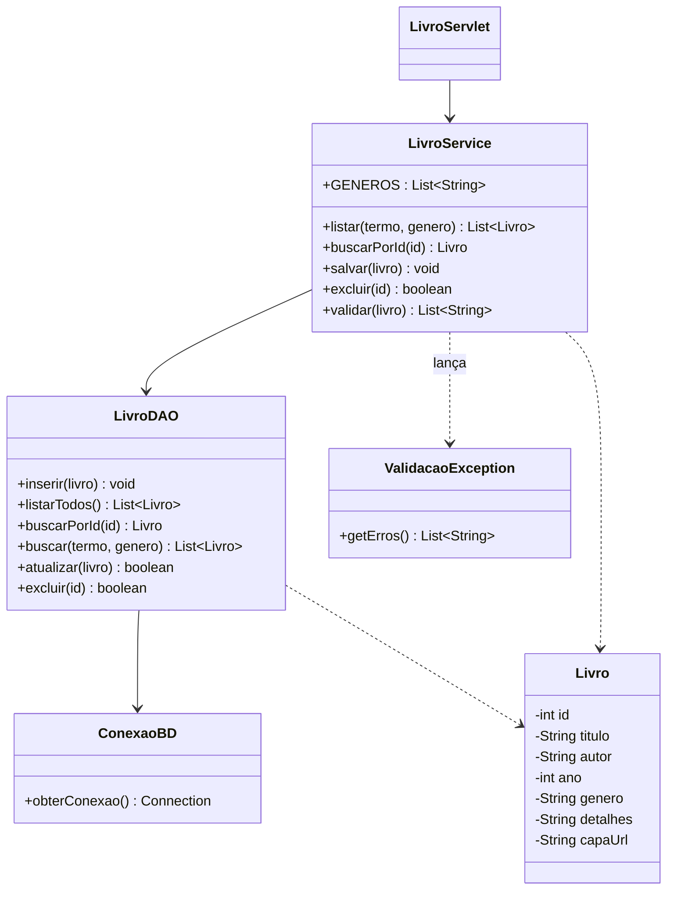

# Catálogo de Livros

Aplicação web para cadastrar, consultar, editar, excluir e buscar livros, desenvolvida em **Java (JSP + Servlet)** com banco de dados **MySQL**. Projeto acadêmico.

## Demonstração


## Funcionalidades

| Funcionalidade | Onde está |
|---|---|
| Cadastro de livros | formulário (`/livros/novo`) |
| Listagem de todos os livros | `/livros` |
| Detalhes de um livro | `/livros/detalhes?id=N` |
| Edição | `/livros/editar?id=N` |
| Exclusão (com confirmação) | botão **Excluir** na lista e nos detalhes |
| Busca por título ou autor | campo de busca da lista |
| Filtro por gênero (extensão) | chips de gênero da lista |
| Capa por link externo (extensão) | campo "Link da capa" do formulário |
| Persistência em banco de dados | MySQL, tabela `livros` |

## Tecnologias

| Item | Versão / detalhe |
|---|---|
| Linguagem | Java 17 |
| Build | Maven (empacotamento WAR) |
| Web | Jakarta Servlet 6.0, JSP e JSTL 3.0 |
| Servidor | Apache Tomcat 10.1 (baixado e executado pelo plugin Cargo) |
| Banco de dados | MySQL 8 com `mysql-connector-j` 8.4.0 |
| Testes | JUnit 5.10.2 |
| Interface | HTML, CSS próprio (tema escuro com efeito de vidro) |

## Arquitetura em camadas

Cada camada tem uma única responsabilidade e só conversa com a camada vizinha.

```
 Navegador
     │  HTTP
     ▼
 ┌──────────────┐   escolhe a tela    ┌──────────────────┐
 │ LivroServlet │ ──────────────────▶ │ JSPs (views)     │
 │ (controle)   │                     │ lista, detalhes, │
 └──────┬───────┘                     │ formulario, erro │
        │ chama                       └──────────────────┘
        ▼
 ┌──────────────┐
 │ LivroService │  validações e regras de negócio
 └──────┬───────┘
        │ chama
        ▼
 ┌──────────────┐        ┌───────────┐
 │  LivroDAO    │ ─────▶ │   MySQL   │  (via ConexaoBD)
 └──────────────┘  SQL   └───────────┘

 Livro (modelo) circula entre todas as camadas.
```



### Responsabilidade de cada classe

| Classe | Pacote | Papel |
|---|---|---|
| `Livro` | `modelo` | Entidade: atributos privados (encapsulamento), três construtores, getters e setters. |
| `ConexaoBD` | `dao` | Abre conexões lendo usuário, senha e URL do `db.properties`. |
| `LivroDAO` | `dao` | Único lugar com SQL: inserir, listar, buscar por id, buscar por termo/gênero, atualizar e excluir. |
| `LivroService` | `service` | Valida os dados, normaliza textos e decide entre inserir e atualizar. |
| `ValidacaoException` | `service` | Exceção que carrega a lista de mensagens de erro de validação. |
| `LivroServlet` | `servlet` | Controlador único: recebe as requisições e escolhe a JSP. |

## Estrutura de pastas

```
catalogo-livros/
├── pom.xml                              dependências e plugins (Maven)
├── database/
│   └── schema.sql                       cria o banco, a tabela, dados de exemplo e o usuário da aplicação
└── src/
    ├── main/
    │   ├── java/br/edu/catalogo/
    │   │   ├── modelo/                  Livro.java
    │   │   ├── dao/                     ConexaoBD.java, LivroDAO.java
    │   │   ├── service/                 LivroService.java, ValidacaoException.java
    │   │   └── servlet/                 LivroServlet.java
    │   ├── resources/
    │   │   └── db.properties            URL, usuário e senha do banco
    │   └── webapp/
    │       ├── index.jsp                redireciona para /livros
    │       ├── css/estilo-escuro.css    estilos da interface
    │       └── WEB-INF/
    │           ├── web.xml              UTF-8, página inicial e páginas de erro
    │           ├── jspf/                cabecalho.jspf, rodape.jspf (trechos reaproveitados)
    │           └── views/               lista.jsp, detalhes.jsp, formulario.jsp, erro.jsp
    └── test/java/br/edu/catalogo/
        ├── service/LivroServiceTest.java   testes unitários (JUnit)
        └── dao/VerificaConexao.java, VerificaDAO.java   verificações manuais com o banco
```

As JSPs ficam dentro de `WEB-INF/views`, então o navegador não consegue abri-las diretamente: elas só aparecem quando o Servlet as encaminha.

## Rotas

Todas são tratadas por `LivroServlet`.

| Método | URL | O que faz |
|---|---|---|
| GET | `/livros` | Lista os livros. Aceita `?busca=texto` e `?genero=Romance`. |
| GET | `/livros/detalhes?id=N` | Mostra um livro. Se não existir, volta à lista com aviso. |
| GET | `/livros/novo` | Formulário vazio de cadastro. |
| GET | `/livros/editar?id=N` | Formulário preenchido para edição. |
| POST | `/livros/salvar` | Cadastra (sem `id`) ou atualiza (com `id`). |
| POST | `/livros/excluir` | Exclui o livro do campo `id`. |

Depois de um POST bem-sucedido, o Servlet redireciona para a lista (padrão *Post/Redirect/Get*), então atualizar a página com F5 não repete o cadastro. A mensagem de sucesso é guardada na sessão, exibida uma vez e apagada.

## Banco de dados

Banco `catalogo`, codificação `utf8mb4`. Tabela `livros`:

| Coluna | Tipo | Regras |
|---|---|---|
| `id` | INT UNSIGNED | chave primária, AUTO_INCREMENT |
| `titulo` | VARCHAR(150) | obrigatório, indexado |
| `autor` | VARCHAR(100) | obrigatório, indexado |
| `ano` | SMALLINT | obrigatório, `CHECK` entre 1 e 2100 |
| `genero` | VARCHAR(40) | obrigatório, indexado |
| `detalhes` | TEXT | opcional (sinopse) |
| `capa_url` | VARCHAR(500) | opcional (link da imagem) |

O script cria também o usuário `catalogo_app`, com permissão apenas de `SELECT`, `INSERT`, `UPDATE` e `DELETE` no banco `catalogo` (princípio do menor privilégio). A aplicação nunca usa o `root`.

## Regras de validação

Executadas em `LivroService.validar`, antes de gravar. Todos os erros são devolvidos de uma vez e o formulário volta preenchido.

| Campo | Regra |
|---|---|
| Título | obrigatório, até 150 caracteres |
| Autor | obrigatório, até 100 caracteres |
| Ano | número inteiro de 1 a 2100 |
| Gênero | precisa estar na lista de gêneros do sistema |
| Sinopse | opcional, até 2000 caracteres |
| Link da capa | opcional; se informado, precisa ser `http://` ou `https://` com endereço válido (até 500 caracteres) |

O formulário HTML também valida no navegador (campos obrigatórios, tipos e tamanhos), mas isso é só conveniência: a validação do servidor é a que vale.

## Segurança

| Risco | Como foi tratado |
|---|---|
| SQL Injection | Todos os comandos usam `PreparedStatement` com parâmetros `?`; nenhum texto do usuário é concatenado no SQL. Na busca, os caracteres `%` e `_` também são tratados como texto comum. |
| XSS (HTML/JavaScript injetado em campos) | Todo texto exibido nas JSPs passa por `<c:out>`, que escapa o conteúdo. |
| Links perigosos na capa | A validação só aceita `http://` e `https://`, o que barra esquemas como `javascript:`. |
| Acesso direto às telas | As JSPs ficam em `WEB-INF` e só abrem via Servlet. |
| Vazamento de detalhes técnicos | Erros de banco vão apenas para o log do servidor; o usuário vê uma mensagem genérica. |
| Privilégios excessivos no banco | A aplicação usa um usuário próprio, sem permissão de alterar a estrutura. |
| Acentos corrompidos | UTF-8 em todo o caminho: páginas, formulário (`setCharacterEncoding`) e conexão com o MySQL. |

## Como executar

**Pré-requisitos:** JDK 17 ou superior, MySQL 8 em execução e IntelliJ IDEA (que já traz o Maven).

1. **Criar o banco.** No MySQL Workbench, abra `database/schema.sql` e execute o script inteiro com um usuário administrador.
2. **Conferir a configuração.** Em `src/main/resources/db.properties`, confirme URL, usuário (`catalogo_app`) e senha. Se você trocou a senha no script, troque aqui também.
3. **Testar a conexão (opcional).** Execute `VerificaConexao` (botão de play ao lado do `main`). O esperado é `Conexão OK! Livros na tabela: 5`.
4. **Subir a aplicação.** No IntelliJ, abra a janela **Maven**, clique em *Execute Maven Goal* e rode:

   ```
   clean package cargo:run
   ```

   Na primeira vez o Maven baixa as dependências e o Tomcat, então pode demorar.
5. **Acessar.** Abra `http://localhost:8080/catalogo/`. Para parar o servidor, use o botão vermelho *Stop*.

> O comando precisa conter `package` antes de `cargo:run`: o plugin Cargo só executa o arquivo `catalogo.war`, que é criado na etapa de empacotamento.

## Testes

- **Unitários (JUnit):** `LivroServiceTest` tem 12 testes das regras de validação (título e autor vazios ou longos, ano fora do intervalo, gênero inválido, link de capa perigoso, vários erros de uma vez, texto com aspas e HTML). Não usam banco nem Tomcat e rodam automaticamente em `mvn package` (ou com `mvn test`).
- **Verificações manuais com o banco:** `VerificaConexao` confere a conexão. `VerificaDAO` lista, busca, tenta um SQL Injection (`' OR '1'='1`, que retorna zero resultados), insere, atualiza e exclui um livro de teste, deixando o banco como estava. Não são testes JUnit de propósito, para o `mvn package` não falhar quando o MySQL está desligado.
- **Testes de tela (manuais):** cadastro, edição, exclusão e busca foram conferidos no navegador com o sistema rodando.

## Documentação do código

Os comentários de documentação (Javadoc) estão em todas as classes. A versão em HTML fica em `docs/javadoc/index.html`. Para gerar de novo, a partir da raiz do projeto:

```
mvn javadoc:javadoc
```

O resultado vai para `target/site/apidocs`.
